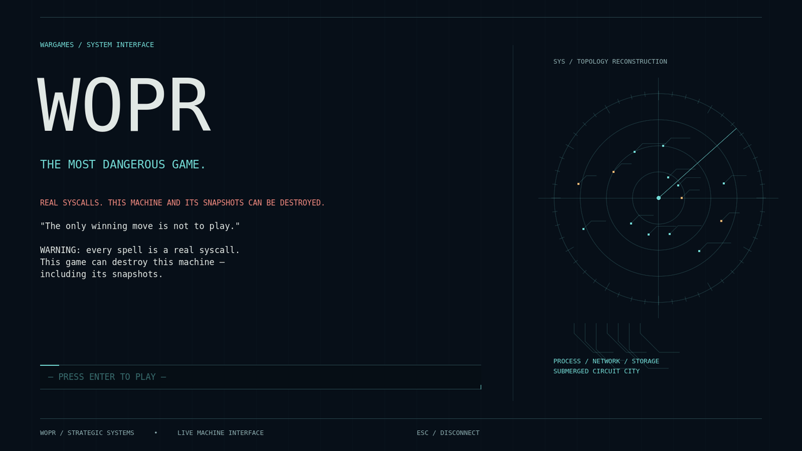
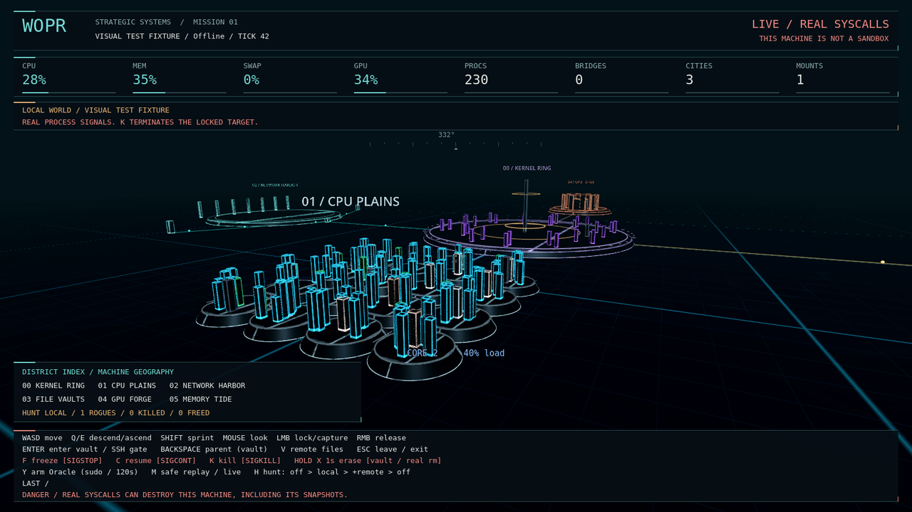
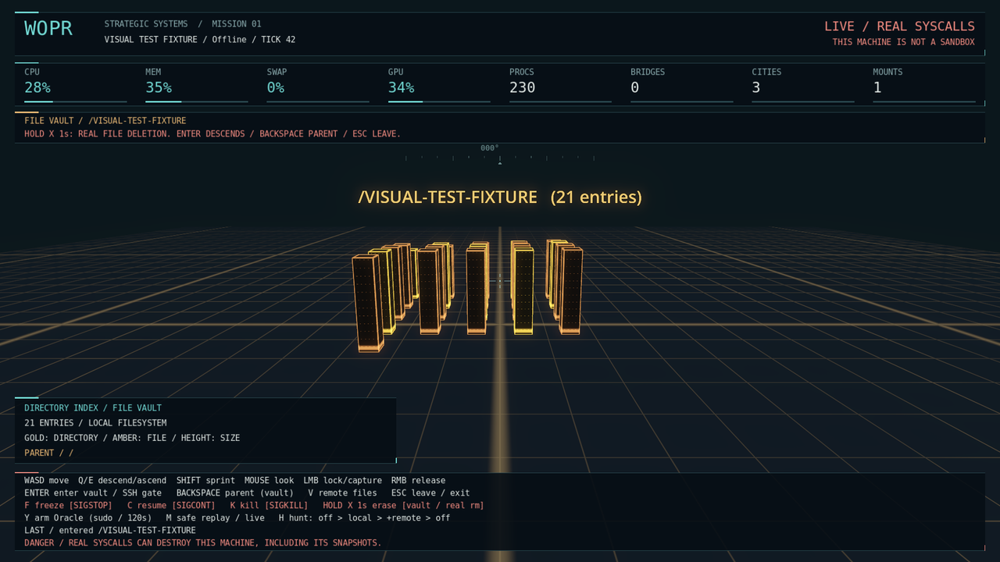
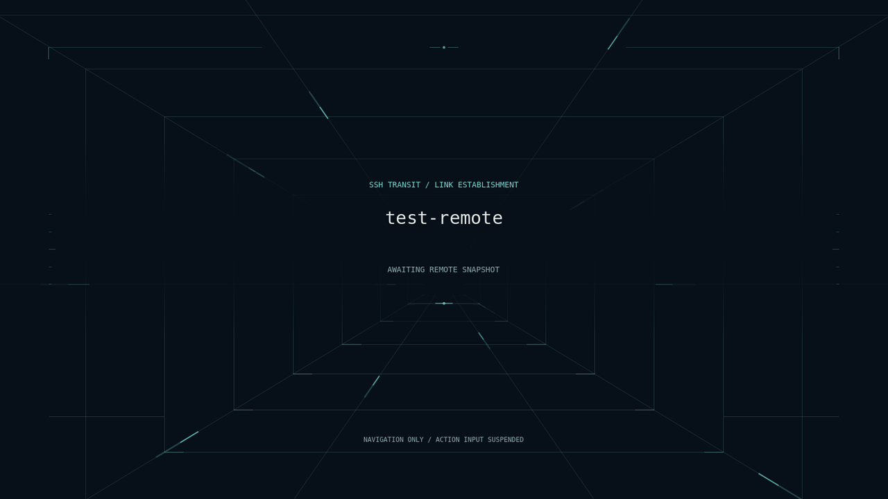
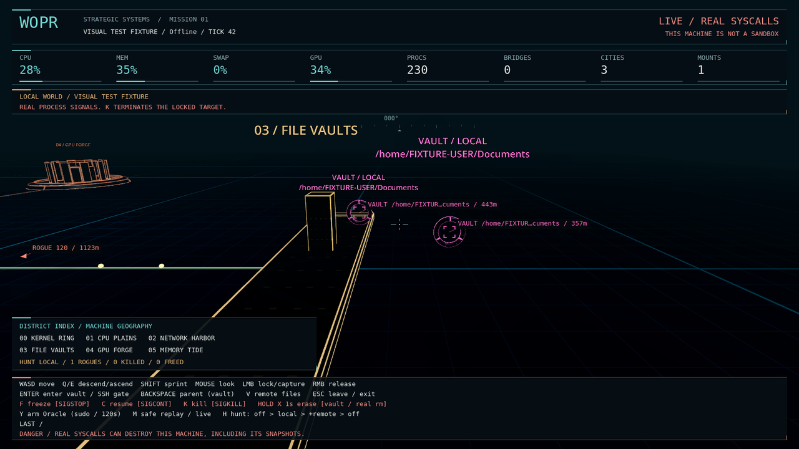
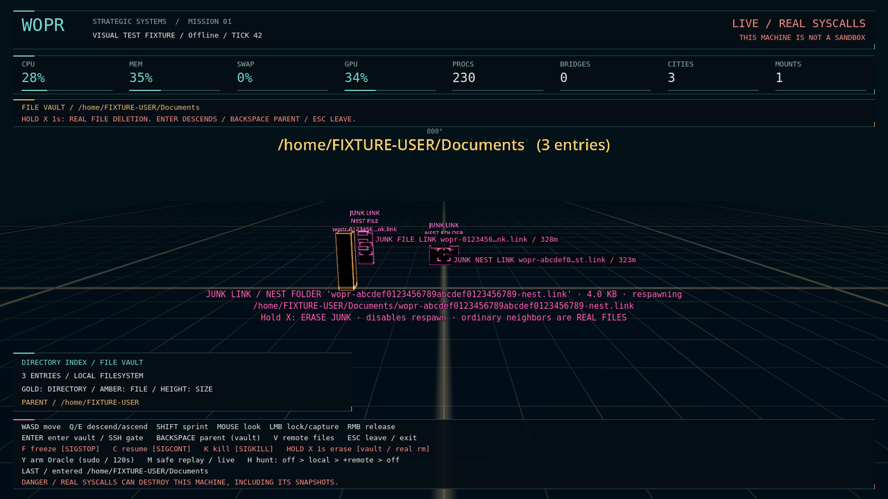
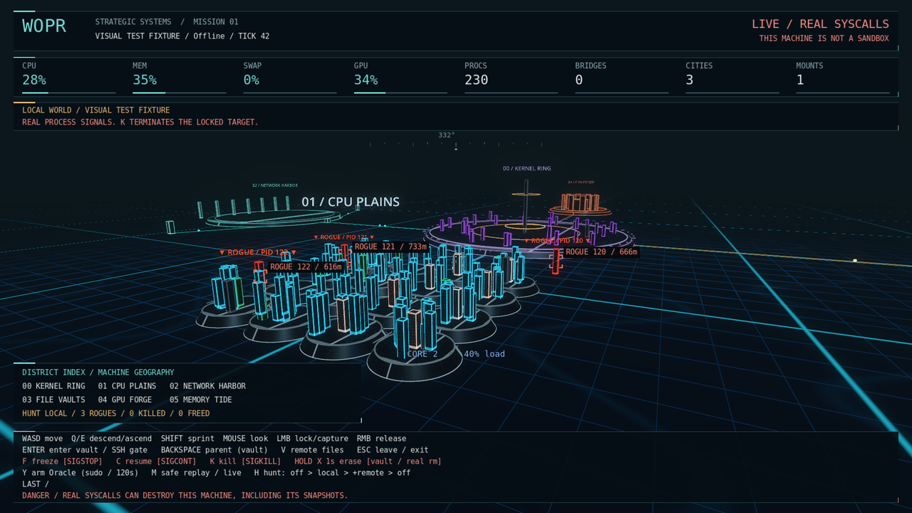
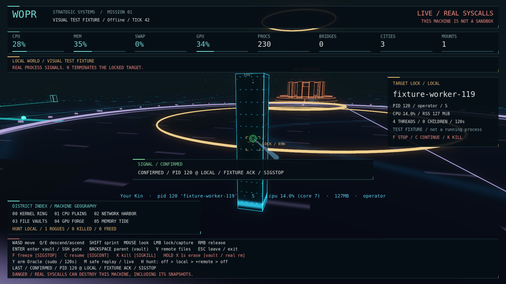

# WOPR

*The most dangerous game.*

An open world exploration game where the world is the virtual insides of the
actual machine running the game. Every monolith is a real process. Every spell
is a real syscall. "Shall we play a game?"

> **Linux required.** Native macOS and Windows are not supported.
> Godot is cross-platform, but WOPR's system backend currently requires Linux.
> On a Mac, use a Linux virtual machine. The local game world then represents
> the Linux guest, not macOS.

## ⚠️ THIS GAME CAN DESTROY YOUR SYSTEM

This is not a simulation and there is no sandbox. Every verb is a real syscall
executed by a real daemon running as you:

- **`K` is a real `SIGKILL`.** Aim at the wrong monolith and you kill your
  browser, your compositor, your SSH session, your work. Unsaved = gone.
- **Hold-X in a vault is a real `rm -rf`.** The daemon guards a short list of
  protected paths (`/`, `~`, mount roots) — that is a guardrail, not a wall.
  Anything you own and the guard list misses is destructible, permanently.
- **The backup is not safe either.** Your btrfs snapshots live on the same disk,
  inside the same filesystem, under paths like `@/.snapshots`. A recursive erase
  aimed carelessly — or, in YOLO tier, deliberately — destroys the snapshots
  *along with* the data they were supposed to rescue. There is no undo, no
  trash, and no rollback of the rollback. If you want a real safety net, it must
  live off this machine.
- **SSH travel extends all of this to every host in your `~/.ssh/config`.**
  A smite or erase abroad is a real remote `kill` / `rm -rf` on that machine.

Play it on a machine you can afford to lose, or with backups you can afford to
lose the machine for. That tension — a beautiful world you are *allowed* to
ruin — is the entire point of the game.

## Screenshots

Captured from the real Godot renderer using **explicitly synthetic, offline test
fixtures**. The telemetry, PIDs, hosts, paths and signal replies shown here are
not live machine data; the captures execute no real system actions.

| Opening console | Live-world presentation |
| --- | --- |
|  |  |
| File-vault interior | SSH link transition |
|  |  |
| Vault destination beacons | Junk nests inside a vault |
|  |  |





## Layout

- `telemetry/frameshiftd.py` — world-state daemon (psutil). Serves
  `http://127.0.0.1:8765/world.json` (world snapshot, 1 Hz) and accepts
  `POST /action` for Tier-2 verbs (real `kill()` with a protected set).
- `game/` — Godot 4.7 project. Procedurally builds the world from live
  telemetry: one monolith per process, height = RAM, glow = CPU, frozen
  (SIGSTOP'd) processes turn to grey stone and stop breathing.

## Run it

Download or clone this repository first. Install Godot 4.7 and Python 3 with
`psutil`. Run this command from the repository's top-level folder:

```sh
godot --path game/
```

The game adopts a running `frameshiftd` if one answers on `127.0.0.1:8765`,
otherwise it spawns its own as a child with a parent-death watchdog. Either
way, **quitting the game stops everything** — recording, enemies, the Oracle.
To run the daemon separately (e.g. for remote-host enemy hunting before you
launch the game): `python3 telemetry/frameshiftd.py`.

## Visual presentation

The native Godot presentation follows a **WarGames command console / submerged
circuit city** direction: dark architectural surfaces with luminous edge and
circuit detail, raised CPU islands, orbital kernel rings, an industrial GPU
reactor, and a quieter translucent memory tide. Process height still follows RAM
on a logarithmic scale; PID 1 is the taller capital landmark. CPU activity drives
the signal lighting, frozen processes stay grey, and locked targets get an amber
flight-instrument bracket.

The monospace HUD separates telemetry, target details, navigation, and commands.
LIVE, safe SIM replay, remote-machine actions, and ROOT ARMED states remain
explicit. Opening, exit, and Oracle screens share the same visual language.
Fonts use system monospace fallbacks; no downloads or external assets are needed.
The default renderer remains Forward+, with 4× MSAA; the art also works with
Godot's Compatibility renderer.

### Travel and signal feedback

Entering a file vault plays an amber descent; SSH travel uses a cyan tunnel/link
sequence. The scene stays covered and actions stay suspended while the real
snapshot/listing is pending. A valid reply materializes the destination with a
short camera/geometry arrival. Refusal, cancellation, or timeout preserves the
original world. **Esc cancels a pending journey.** Held action keys must be
released after arrival; stale responses cannot switch to an old destination.
Remote subdirectory and parent navigation keep the same SSH host.

Outdoor terrain and memory water belong only to the local world. Separate
raycast layers isolate local processes, remote processes, and vault entries, so
hidden-world colliders cannot intercept targeting. Vault/remote titles use
readable world-space sizes; the vault's HUD index describes its directory rather
than unrelated outdoor districts.

Target lock emits a cyan pulse. **F** fires an ice-blue freeze beam, **C** a jade
resume beam, and **K** a coral/amber smite shot. Beams terminate at the real
camera-facing pick surface. Shots are labelled **awaiting daemon** until their
response arrives: green pulses mean acknowledged success, red pulses and the
result panel show refusal/failure. A missing or invalid reply is **unconfirmed**,
not evidence that a syscall did or did not occur. No visual effect executes an
action on its own, and a pending shot cannot be redirected by travel or a second
shot. Armed local smite still uses the Oracle; remote smite still targets the
acknowledged remote host.

### Hunt visibility

Hunt targets render as pulsing red process towers across the field, with
readable `ROGUE / PID` labels. Screen-space brackets show their PID and range;
edge arrows marked `BEHIND` keep off-screen rogues findable without selecting or
firing at them. Local and remote hunt markers use their own PID namespaces and
do not leak into file vaults. Target lock and signals remain deliberate player
actions: aim, left-click to lock, then F/C/K.

### Safe visual verification

**Do not launch the real game just to test a shader.** The isolated test subclass
never starts/adopts/stops a daemon, disables gameplay input, and supplies labelled
synthetic fixtures instead of contacting the API:

```sh
python3 game/tests/verify_visuals.py
# Optional: real shader rendering and screenshots on an isolated X server.
# Requires xvfb-run; screenshots cover 1600×900 and 1152×648.
python3 game/tests/verify_visuals.py --render --output "$TMPDIR/wopr-visual-tests"
```

This covers title, world, target lock, remote world, vault, SIM, ROOT ARMED,
Oracle ritual, and farewell. Regression tests exercise hidden-world picking,
readable titles, arrival/return, refusal/timeout/cancellation/stale replies,
remote path context, held-key gating, signal payloads and acknowledgements,
root-versus-remote routing, malformed responses, surface impacts, and effect
cleanup. Tests replace the transport boundary with offline fixture replies;
HTTP clients must remain disconnected. A separate startup-probe regression runs
the production TCP probe against an ephemeral loopback listener and a refused
endpoint, without spawning or stopping a daemon. The render option additionally compiles
the shaders, saves both-size screen captures, and records vault/SSH/shot frame
sequences. It does **not** exercise real signals, file deletion, SSH, or sudo.

Presentation code: `game/scripts/console_ui.gd`, `flight_overlay.gd`,
`travel_overlay.gd`, `action_effects.gd`, `world_art.gd`, and `game/shaders/`.
Navigation and action orchestration remain in `main.gd`; telemetry and
privileged action policies are unchanged by the presentation layer.

## Controls

| Key | Verb | Reality |
|---|---|---|
| WASD / Q,E | move | — |
| Shift | sprint | — |
| Left-click | target | raycast |
| `F` | freeze | `kill(pid, SIGSTOP)` — real |
| `C` | resume | `kill(pid, SIGCONT)` — real |
| `K` | smite | `kill(pid, SIGKILL)` — real |
| `H` | hunt: cycle off / local / +remote rogues | spawns real burners and junk writers |
| `Enter` | descend vault / travel gate / follow junk marker | — |
| `V` | browse remote files (in a remote world) | — |
| Hold-`X` | erase (in a vault) | `rm -rf` — real, guarded (as root when armed) |
| `Y` | arm the Kernel Oracle | sudo ritual · root verbs for 120s |
| `M` | sim mode: replay the recorded window | all real verbs frozen server-side |
| `Esc` | leave vault / return home / two-stage exit | — |

Yes, those are real. A Tier-2 protected set (PID 1, the daemon, its ancestors)
is enforced daemon-side; everything else on your user account is fair game.

## Danger tiers (design)

1. **Sim** — the daemon always records a rolling 30-minute window of real
   world snapshots; press **M** to replay it. While a replay plays, the
   daemon **refuses every real verb server-side** — kills, rm, ssh, enemy
   spawns, even the Oracle. Safety is enforced by the daemon, not the UI.
   Saves/loads via `~/.local/share/wopr/saves/*.wopr.gz`. *(built)*
2. **Live** — real PIDs, real signals, protected set, no file verbs. **← built**
   Plus: **vaults** (enter mounts/dirs, hold-X erase guarded `rm -rf`) and
   **SSH travel** (gateways from `~/.ssh/config` → remote worlds, remote
   kill/rm via fixed verbs, remote file browsing with `V`).
3. **YOLO** — root "Kernel Oracle" helper: `kill` any pid, `systemctl`,
   `modprobe ±r`, `rm -rf`, snapshots. Press **Y** in-game, speak the
   incantation (your sudo password — piped to sudo, never stored), and the
   Oracle arms **only if a snapper snapshot exists** — a *ritual*, not a
   promise: erasing the snapshot store is a supported verb (it demands
   `--i-know` and logs it in caps). Armed for 120s, then cold. Every verb
   is written to a write-ahead log *before* it runs.
   *(built — first live use is your call, on a machine you can afford)*
   One-time setup: `sudo snapper -c root create-config /` and a
   `sudo snapper -c root create -c pre -d "wopr baseline"`.

The Oracle exposes **verbs, never a shell** — fixed argv arrays, allowlisted
actions, path arguments only. Zero Rust dependencies, ~450 auditable lines
(`oracle/`). The daemon itself never runs as root; the Oracle is spawned by
`sudo -S` and its socket is 0600 owned by the user who armed it.

## Enemies

Press **H** to enable local hunting. Press it again to include reachable SSH
hosts, or once more to turn hunting off. Red ROGUE towers are real processes.
Ordinary rogues burn CPU and hold RAM. Freezing one buys only 8 seconds.
Rogues roam across the field. They enter the network and SSH area only when
local-plus-remote hunting is enabled. Roaming does not trigger travel.

Some rogues write junk and leave a nest that lets them respawn after you kill
them. Pink outdoor markers guide you to the affected **vault**. The actual
**JUNK / NEST** files appear inside that vault, beside ordinary files.
Killing the writer does not remove its nest.

1. Kill the rogue with **K**, or leave it running while you find its nest.
2. Follow the pink vault indicator and press **Enter** at its beacon to open the affected folder.
3. Find the marked entry and hold **X** to erase it and disable that nest's respawn.

The marked entries are symlinks among real files in random existing folders
under that host's home. Their backing junk stays in WOPR's private session
storage. **Deleting a neighboring real file is still a real deletion.**

Turning Hunt off or closing the game removes its junk links and backing data.
Remote junk requires the local-plus-remote Hunt tier. If SSH cleanup fails,
the remote helper's expiry lease supplies a fallback and the failure is reported.
SIM stops junk writers and prevents real erasure.

Developer commands and lifecycle details are in [docs/DEVELOPMENT.md](docs/DEVELOPMENT.md).

## Roadmap

- [x] Live telemetry daemon (procs, cpu, mem, disk, sockets, listeners)
- [x] Godot world render + fly camera + HUD
- [x] Tier-2 freeze/resume/smite with protected set
- [x] Network bridges rendered as light-roads to remote-host towers
- [x] Memory as water level, swap pressure as flood (blood-crest at high swap)
- [x] zombie processes = ghosts (pale monoliths)
- [x] systemd respawn = hydra enemies (respawn within 10s of a smite = Hydra)
- [x] Sim mode (record/replay a world snapshot)
- [x] The Kernel Oracle (Rust) + YOLO arming ritual + snapper rollback (staged via bootloader)
